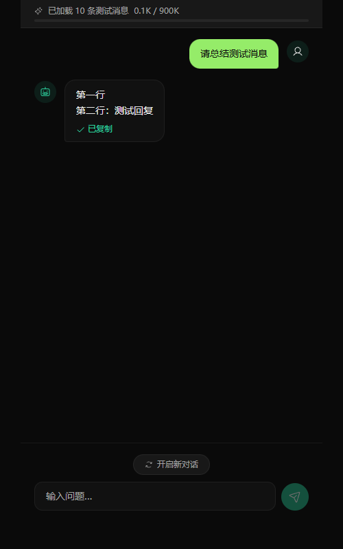

# AI 后端与降级

## 1. 功能定位

AI 后端为摘要、对话、Agent 和记忆整理提供统一调用接口。项目支持 Anthropic 和 OpenAI-compatible Provider，也允许用户使用自建或代理服务。

配置入口位于系统配置页面，主要字段为：

- `AI_PROVIDER_BASE_URL`
- `AI_PROVIDER_API_KEY`
- `AI_PROVIDER_TYPE`
- `AI_PROVIDER_MODEL`
- `AI_PROVIDER_EXTRA_BODY`

## 2. Provider 选择

```text
URL + API Key 均存在
  → type=auto：自动探测接口形态
  → type=anthropic：Anthropic 后端
  → 其他：OpenAI-compatible 后端

URL 或 API Key 缺失
  → StubSummarizer
  → 应用继续运行，AI 专用功能返回配置提示
```

“自定义 Provider”表示兼容 OpenAI Chat Completions 形式，并不代表可以直接接入任意协议。

## 3. 调用类型

| 调用 | 场景 |
|---|---|
| `chat` | 通用对话、记忆总结、部分助手工具 |
| `agent_chat` | Agent 工具调用和 ReAct 循环 |
| 流式聊天 | Web AI Chat、朋友圈 AI 总结 |
| 摘要调用 | 群聊摘要、公众号摘要 |
| 长文本调用 | 公众号文章和长内容整理 |

## 4. 未配置 AI 时

未配置 AI 不会阻止应用启动。

### 仍可用

- 消息、收藏、朋友圈浏览与导出；
- 关键词提醒；
- 公众号文章读取和即时提醒；
- script 类型 Skill；
- 不依赖云端 AI 的本地检索和任务功能。

### 不可用

- 群聊/公众号定时摘要；
- 收藏、聊天、朋友圈 AI 对话；
- Agent；
- prompt 类型 Skill；
- AI 记忆整理和上下文压缩。

Stub 的提示包括：

```text
AI 未配置，请先在系统配置中设置 AI 提供商。
AI 未配置，无法调用摘要接口
AI 未配置，无法使用 Agent 功能
```

## 5. 错误分类

Provider 检测会区分：

- URL 或 API Key 未填写；
- 凭据无效；
- 地址无法连接；
- Provider 返回不兼容响应；
- 模型或上下文超限。

AI 调用失败时，摘要任务会进入失败状态；不会把错误当成“没有新内容”。

### 5.1 LLM 健康记录与面板 AI 状态

`src/summarize/base.py` 维护一份**进程级单事件**健康记录 `_llm_health = {ok, ts, msg}`，只保留最近一次真实调用的结果：

- `_retry_with_backoff` 成功即写 `ok=True`；重试全部耗尽写 `ok=False` 与原因（截断到 200 字符）。覆盖 `chat()`、`agent_chat()`、`consolidate_memory()`；
- 群摘要 `_call_digest_api`（`scheduler.py`）和公众号长文摘要 `_call_long_api`（`oa_digest.py`）直接调后端 API，由调用点自行登记：成功记 success，非上下文超限异常记 failure（上下文超限是内容问题不是 AI 挂了，不写记录避免假红）；
- 流式对话（`/api/ai/chat/message`、朋友圈 AI 总结）不经过重试包装，由调用点自行登记：首个 token 到达算成功（Stub 后端除外，见下），异常或首 token 超时算失败；
- 记录必须是模块级而非实例属性：OA 即时提醒和网页对话每次都新建 summarizer，记在实例上调用方互相看不到。

**只登记真实 LLM 调用结果**：`/api/sandbox/test` 与 `/api/assistant/ai/*` 的外层 `except` 还覆盖配置读取、会话/数据库操作、`send_json` 等与 AI 可用性无关的异常，写进健康记录会造成面板假红，因此那些分支只刷新广播、不写记录（其内部真正的 `chat()` 失败已由重试层登记）。同理，Stub 后端流式返回的"AI 未配置…"提示语不算成功。

消费方：首页面板 `_ServerStatus`（`src/web/server.py`）与 bot 侧 `HealthMonitor._check_ai_ok()`（`src/bot.py`）读同一份记录。`ts == 0`（从未发生过真实调用）时才回退到配置检测结论 `ai_verified`；一旦出现调用结果就以结果为准。`_ServerStatus.update()` 忽略调用方传入的 `ai_ok` / `ai_error`，因此 bot 30 秒心跳不会把红色状态顶回绿色。面板文案：可达 / 不可用（附最近一次失败原因）/ 未响应。

未纳入登记的调用：无（所有 LLM 路径均已覆盖）。

回归用例：`tests/test_llm_health.py`（14 条，含"心跳不得复活面板"和"Stub 流式不算可达"）。

## 6. SSE 对话

```text
POST /api/ai/chat/start
  → 读取本地上下文并创建 session

POST /api/ai/chat/message
  → SSE token 事件持续返回内容
  → done 事件表示完成
  → error 事件表示失败
```

聊天上下文有字符上限和压缩机制。关闭对话面板不会自动删除 session，用户选择“开启新对话”时才会销毁旧 session。

### 6.1 空回复恢复与复制

OpenAI 兼容后端的流式请求默认使用 4,096 输出 token。若模型只输出思考内容而没有
回复正文，会尝试关闭思考并以至少 8,192 token 重试；中转明确拒绝 `thinking`
参数时，仅增加输出额度。已经输出正文后不会重播，内部思考也不会作为答案显示。
重试仍无正文则发送错误事件并记录失败，不保存空的 assistant 消息。

群聊、私聊和收藏共用的对话面板按完整 SSE 事件解析，支持跨网络分段的中文内容。
空完成事件、异常断线及超时会显示原因；断线前收到的正文保留供查看。
首次响应等待最多 120 秒（包含等待响应头和推理恢复），收到正文后按 60 秒无内容超时处理。

回复下方的“复制”按钮支持多行内容，并显示成功或失败结果；WebView 或局域网
HTTP 环境缺少 Clipboard API 时使用兼容方式复制，也可以手动选择文字。



回归检查：

```powershell
python -m pytest tests/test_ai_chat_stream.py tests/test_llm_errors.py tests/test_llm_health.py -q
node --test ui/tests/sse.test.mjs
```

## 7. 当前已知体验差异

未配置 AI 时，部分 AI 专用接口仍可能先返回会话或普通回复，随后才在真正调用阶段显示未配置提示；Dashboard 也可能显示“未响应”而不是“未配置”。这属于状态表达问题，不影响消息读取、提醒和导出等非 AI 主链。

## 8. 代码位置

- Provider 工厂：`src/summarize/__init__.py`
- Stub：`src/summarize/stub_backend.py`
- Provider 检测：`src/summarize/provider_detector.py`
- AI 异常：`src/summarize/errors.py`
- Web AI Chat：`src/web/ai_chat.py`
- 前端 AI Chat：`ui/src/components/AIChatPanel.jsx`
